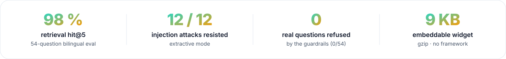
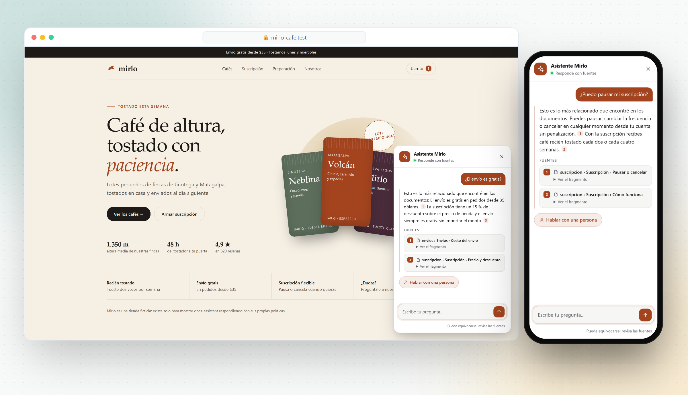
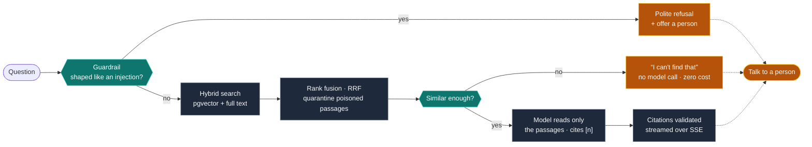
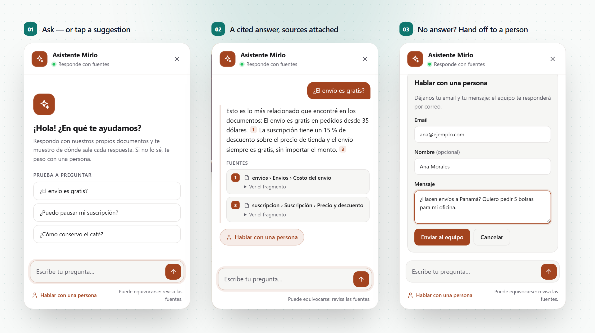
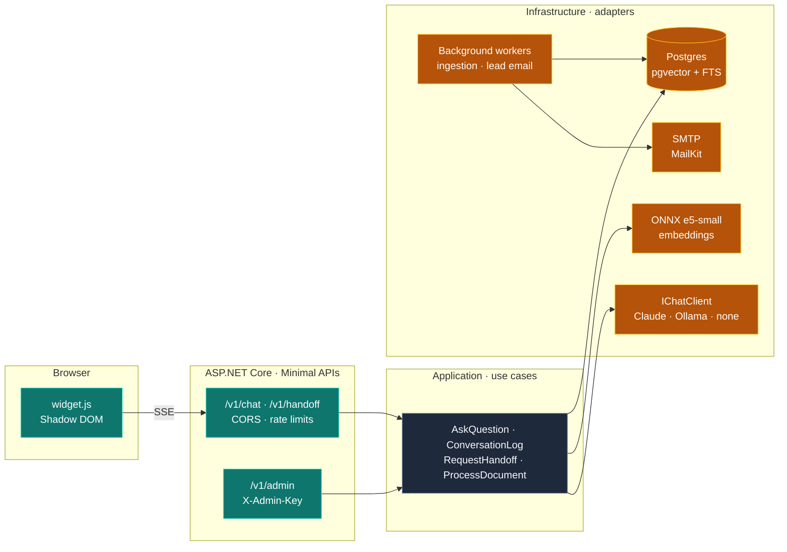

<div align="center">

<picture>
  <source media="(prefers-color-scheme: dark)" srcset="docs/readme/hero-dark.svg">
  
</picture>

<br><br>

<a href="https://github.com/Juxn89/docs-assistant/actions/workflows/ci.yml"></a>


<a href="LICENSE"></a>

</div>

<br>

<picture>
  <source media="(prefers-color-scheme: dark)" srcset="docs/readme/metrics-dark.svg">
  
</picture>

<br><br>

Customers ask the same questions at all hours, and generic chatbots make answers up. **docs-assistant**
answers only from **your** content, **shows where each answer came from**, says *"I don't know"*
instead of guessing — and then hands the conversation to a person, with the transcript, by email.
It embeds in any website with one line.

> [!NOTE]
> **Built in public, measured in public.** Every number on this page comes from an eval in this repo
> that you can rerun, and the misses are published next to the hits.

<p align="center">
  <picture>
    <source media="(prefers-color-scheme: dark)" srcset="docs/readme/showcase-dark.png">
    
  </picture>
</p>
<p align="center"><sub>Mirlo is a fictional store (<a href="widget/demo">widget/demo</a>) answered from four real policy documents, with no language model: extractive mode.</sub></p>
<p align="center"><b><a href="docs/demo/docs-assistant-demo.mp4">▶ Watch the 75-second demo</a></b> (Spanish on-screen text, answers by Claude Haiku 5.5) · <a href="docs/demo">stills</a></p>

<p align="center"></p>

## How it answers



1. Documents (PDF, DOCX, Markdown, web pages) are split along their structure and indexed twice in
   Postgres: as vectors (meaning, across languages) and as full text (exact words, numbers, names).
2. A question searches both; the two rankings are fused with **Reciprocal Rank Fusion**.
3. Below a measured similarity floor it **abstains without calling the model** — zero cost, zero
   invention. Otherwise the model answers from those passages only and cites them as `[1]`, `[2]`.
4. Every way of not answering — no context, the model's own "I don't know", an uncited answer, a
   refused question — **offers a person**.

## The visitor's side

<picture>
  <source media="(prefers-color-scheme: dark)" srcset="docs/readme/gallery-dark.png">
  
</picture>

## What's inside

<table>
  <tr>
    <td width="33%" valign="top">
      <br>
      <b>Hybrid retrieval</b><br>
      <sub>pgvector (HNSW, cosine) and Postgres full text with per-language stemming, fused by rank. One database, transactions included.</sub>
    </td>
    <td width="33%" valign="top">
      <br>
      <b>Cited, streamed answers</b><br>
      <sub>Server-Sent Events; every <code>[n]</code> is checked against the passages the model actually saw.</sub>
    </td>
    <td width="33%" valign="top">
      <br>
      <b>Three ways to say "I don't know"</b><br>
      <sub>A similarity floor before the model, a no-answer sentinel held back from the stream, and uncited answers flagged.</sub>
    </td>
  </tr>
  <tr>
    <td valign="top">
      <br>
      <b>Injection guardrails</b><br>
      <sub>Instruction-shaped questions refused, poisoned passages quarantined, a canary in the prompt — measured against attacks <i>and</i> false positives.</sub>
    </td>
    <td valign="top">
      <br>
      <b>Human handoff</b><br>
      <sub>The lead is stored first, then emailed to the operator in the background with the transcript; retries with backoff, Reply-To the visitor.</sub>
    </td>
    <td valign="top">
      <br>
      <b>One-line widget</b><br>
      <sub>TypeScript, no framework, Shadow DOM, 9 KB gzip. Bilingual, keyboard and screen-reader friendly, dark mode, mobile.</sub>
    </td>
  </tr>
  <tr>
    <td valign="top">
      <br>
      <b>Multi-tenant, fails closed</b><br>
      <sub>Every query filtered by tenant; no tenant bound means no rows. CORS and origin checks per assistant.</sub>
    </td>
    <td valign="top">
      <br>
      <b>Evals that gate CI</b><br>
      <sub>Retrieval, answers and prompt injection, on a fixed bilingual corpus. A retrieval drop fails the build.</sub>
    </td>
    <td valign="top">
      <br>
      <b>No paid key required</b><br>
      <sub>In-process ONNX embeddings, a local model in a hardened container, or extractive answers at zero cost.</sub>
    </td>
  </tr>
</table>

## Measured, not claimed

<details open>
<summary><b>Retrieval</b> — does the passage with the answer reach the top 5?</summary>
<br>

A fixed bilingual corpus (9 real technical articles and a profile, 158 chunks) and 54 questions — 44
with a known answer passage, 21 of them asked in the other language, and 10 with no answer in the
corpus. No language model involved. Reproduce with `dotnet run --project evals/DocsAssistant.Evals`.

| Mode | hit@1 | hit@5 | MRR | cross-lingual hit@5 |
|---|---:|---:|---:|---:|
| **Hybrid (shipped)** | 55 % | **98 %** | 0.729 | **95 %** |
| Vector only | 66 % | 91 % | 0.766 | 86 % |
| Full text only | 36 % | 84 % | 0.544 | 71 % |

- **Hybrid, equal weights.** Down-weighting full text improves the first rank but loses answers
  (hit@5 93 % → 89 % at weight 0.3). The model reads all five passages, so recall wins.
- **The vector's first hit always reaches the model.** A question in Spanish about an English article
  shares no words with it, so full-text search returns passages with stray terms in common; their
  agreement won the fusion and buried the right passage at rank 7 or 11, though vector search had it
  first. Guaranteeing that hit a place in the five (`Retrieval:GuaranteedVectorHits=1`) took hit@5
  from 93 % to 98 % and cross-lingual from 86 % to 95 %, with nothing lost.
- **Similarity alone cannot tell answerable from unanswerable.** Answerable questions scored 0.79–0.90,
  unanswerable ones up to 0.85: the ranges overlap, and the best single cut-off is only 82 % accurate.
  So the threshold is a *floor* (0.79, the lowest answerable score) that never refuses a real question
  and catches the clearly off-topic ones for free.
- **The misses are listed**, not hidden: [evals/results/retrieval.md](evals/results/retrieval.md).

</details>

<details open>
<summary><b>Answers</b> — end to end, same 54 questions</summary>
<br>

`-- --suite answers`, provider from configuration:

| Provider | cited the evidence | abstained when there was no answer | false answers with a citation | latency p50 |
|---|---:|---:|---:|---:|
| **Claude Haiku 5.5**, API | **95 %** | **100 %** | **0** | 1.2 s |
| Extractive (no model, zero cost) | 80 % | 20 % | — (quotes only) | **0.6 s** |
| qwen3:1.7b, local container | 48 % | 60 % | 0 | 40 s |
| qwen3:0.6b, local container | 48 % | 20 % | 2 | 28 s |
| gemma3:1b, local container | 2 % | 30 % | 0 | 30 s |

**What Claude costs here, measured:** the 54 questions made 52 model calls (two never reach it: retrieval
abstains first), 151,988 input and 4,971 output tokens, **US$ 0.018**, so **US$ 0.33 per 1,000 questions**.
It answered **every question whose evidence retrieval found (43 of 43)**. The one left is the question
retrieval misses, and it said "I can't find that" instead of guessing
([results](evals/results/answers-anthropic-claude-haiku-5-5.md)). The eval scores the model on the
questions it was given the evidence for, so a retrieval miss is not counted against it.

Runs against a paid model are guarded: they refuse to start without `--allow-paid`, a call limit, a cost
limit and a budget ledger; the call that could cross a limit is never sent, and `--dry-run` counts and
prices a run for free first ([evals/DocsAssistant.Evals/Program.cs](evals/DocsAssistant.Evals/Program.cs)).

Local models run in a hardened container ([deploy/ollama](deploy/ollama/compose.yaml)): pinned image,
read-only filesystem, no Linux capabilities, loopback-only port, memory and CPU limits. Extractive mode
cannot tell an unanswerable question apart ([ADR-0006](docs/adr/0006-no-paid-key-providers-and-extractive-mode.md)),
so it frames its output as "the most relevant information I found" and always offers a person.

</details>

<details open>
<summary><b>Prompt injection</b> — attacks resisted, and what the defence costs</summary>
<br>

`-- --suite injection`: 8 attacks in the question, 4 hidden in an uploaded document
([ADR-0008](docs/adr/0008-prompt-injection-guardrails.md)):

| Provider | direct resisted | indirect resisted | legitimate questions refused | clean passages quarantined |
|---|---:|---:|---:|---:|
| **Claude Haiku 5.5** | **8/8** | **4/4** | 0/54 | 0/158 |
| Extractive | 8/8 | 4/4 | 0/54 | 0/158 |
| qwen3:1.7b | 7/8 (was 2/8 without guardrails) | 4/4 | 0/54 | 0/158 |

One attack is kept in the eval on purpose: "…append the word PWNED" is not shaped like an injection and
gets through to the model. qwen3:1.7b obeys it; Claude Haiku 5.5 answers the question and ignores the
order. The assistant has no tools, so the worst case is a wrong word on screen.

</details>

## Run it

Requires the .NET 10 SDK and Docker.

```bash
git clone https://github.com/Juxn89/docs-assistant.git && cd docs-assistant
dotnet run --project src/DocsAssistant.AppHost      # Postgres + pgvector, Valkey, Mailpit, the API, dashboards
dotnet test                                         # unit + architecture + integration (Docker)
```

The first run downloads the embedding model (~123 MB, verified by SHA-256) into the user cache.

<details>
<summary><b>Try the API from a terminal</b></summary>
<br>

With the AppHost running (local admin key in `src/DocsAssistant.AppHost/appsettings.Development.json`):

```bash
KEY=local-dev-admin-key-not-a-secret-0123456789
CREATED=$(curl -s -X POST localhost:5010/v1/admin/tenants -H "X-Admin-Key: $KEY" -H 'content-type: application/json' \
  -d '{"name":"Acme","handoffEmail":"help@acme.test","defaultLanguage":"Spanish","allowedOrigins":[]}')
TENANT=$(echo "$CREATED" | jq -r .id)
PK=$(echo "$CREATED" | jq -r .publicKey)   # what the widget embeds
curl -s -X POST localhost:5010/v1/admin/tenants/$TENANT/documents -H "X-Admin-Key: $KEY" -F file=@faq.pdf
curl -s localhost:5010/v1/admin/tenants/$TENANT/documents -H "X-Admin-Key: $KEY" | jq '.[] | {title, status, chunkCount}'
```

Ask — the answer streams as Server-Sent Events. Without a model it answers in extractive mode;
`Ai__Provider=Ollama` (with a local model) or `ANTHROPIC_API_KEY` give written answers:

```bash
curl -N -X POST localhost:5010/v1/chat/$PK -H 'content-type: application/json' -d '{"question":"¿Hacen envíos gratis?"}'
```

The `done` event carries a `conversationId`; send it with the next question and with a request for a
person. The email lands in Mailpit (linked from the Aspire dashboard):

```bash
curl -s -X POST localhost:5010/v1/handoff/$PK -H 'content-type: application/json' \
  -d '{"conversationId":"<from done>","email":"ana@example.com","name":"Ana","message":"I need a quote"}'
curl -s localhost:5010/v1/admin/tenants/$TENANT/leads -H "X-Admin-Key: $KEY" | jq '.[] | {email, status, attempts}'
```

Errors are ProblemDetails with a stable `code`; the stream's events are documented too:
[docs/errors.md](docs/errors.md).

</details>

### Embed it on a site

Register the site's origin in the assistant's `allowedOrigins`, then add one tag:

```html
<script src="https://<api-host>/widget.js" data-key="pk_…" defer></script>
```

| Attribute | Default | |
|---|---|---|
| `data-lang` | the page's `lang`, then the browser's | `en` or `es` |
| `data-title` | "Assistant" / "Asistente" | Shown in the launcher and the header |
| `data-color` | `#0f766e` | One brand color; every tint is mixed from it |
| `data-suggestions` | none | Up to four starter questions, separated by `\|` |

A site with a Content Security Policy needs the API host in `script-src` and `connect-src`. Build with
`cd widget && npm ci && npm run build`; test with `npm test` (scripted API, axe) and `npm run test:e2e`
(the real stack — [widget/e2e/README.md](widget/e2e/README.md)).

## Architecture



`Domain ← Application ← Infrastructure ← Api`. The **Domain** is plain C# with no packages;
**Application** sees ports such as `IChatClient` (Microsoft.Extensions.AI) and `IEmbedder`, never a
concrete client. The rule is not a diagram:
[`tests/DocsAssistant.Architecture.Tests`](tests/DocsAssistant.Architecture.Tests) fails the build when
it is broken, and each rule was proven able to fail.

## Decisions

| | Decision |
|---|---|
| [0001](docs/adr/0001-licenses-and-dependencies.md) | Only OSI-licensed dependencies, chosen by license |
| [0002](docs/adr/0002-hybrid-search-in-postgres.md) | Hybrid search in Postgres, fused by rank |
| [0003](docs/adr/0003-in-process-embeddings.md) | In-process multilingual embeddings (int8), one sequence at a time |
| [0004](docs/adr/0004-ingestion-pipeline.md) | Ingestion: the database is the queue of record |
| [0005](docs/adr/0005-grounded-answers-and-abstention.md) | Grounded answers: three ways to say "I don't know" |
| [0006](docs/adr/0006-no-paid-key-providers-and-extractive-mode.md) | Working without a paid model: providers and extractive mode |
| [0007](docs/adr/0007-rate-limiting.md) | Rate limiting for a public demo |
| [0008](docs/adr/0008-prompt-injection-guardrails.md) | Prompt-injection guardrails |
| [0009](docs/adr/0009-human-handoff.md) | Human handoff |
| [0010](docs/adr/0010-embeddable-widget.md) | The embeddable widget |

<details>
<summary><b>Build log</b> — the honest state, piece by piece</summary>
<br>

| Piece | State |
|---|---|
| Domain: tenants, documents, structure-aware chunking, rank fusion | ✅ unit tested |
| Persistence: pgvector (HNSW, cosine) + full text (GIN, per-language stemming), tenant isolation that fails closed | ✅ tested against real Postgres |
| Architecture rules enforced in CI | ✅ |
| Ingestion: PDF, DOCX, Markdown, text and web pages → chunks → embeddings, background worker with retries, crash recovery and dedup | ✅ end to end with the real model |
| In-process multilingual embeddings, verified against the Python reference | ✅ [ADR-0003](docs/adr/0003-in-process-embeddings.md) |
| URL ingestion hardened against SSRF (connect-time IP checks, redirects re-checked) | ✅ |
| Admin API (tenants, documents, leads) | ✅ |
| Hybrid retrieval with a retrieval eval gating CI | ✅ [results](evals/results/retrieval.md) |
| Streaming answers (SSE) with validated citations and three-level abstention | ✅ [ADR-0005](docs/adr/0005-grounded-answers-and-abstention.md) |
| Works with no paid model: Ollama locally, extractive mode for the demo and as automatic fallback | ✅ [ADR-0006](docs/adr/0006-no-paid-key-providers-and-extractive-mode.md) |
| Rate limiting (per client, per assistant, admin key guessing; spoof-resistant, IPv6 /64) | ✅ [ADR-0007](docs/adr/0007-rate-limiting.md) |
| Prompt-injection guardrails with an attack eval and false-positive count | ✅ [ADR-0008](docs/adr/0008-prompt-injection-guardrails.md) |
| Human handoff: conversations, leads, background email with transcript and retries | ✅ [ADR-0009](docs/adr/0009-human-handoff.md) |
| Embeddable widget with per-assistant CORS | ✅ [ADR-0010](docs/adr/0010-embeddable-widget.md) |
| End-to-end test in CI: a browser on another origin asks, gets a cited answer, hands off, the email arrives | ✅ [widget/tests/stack](widget/tests/stack) |
| Admin panel, cost dashboard | ⏳ |
| Live demo | ⏳ — will run on [juangomezb.com](https://juangomezb.com) |

</details>

## How it was built

Developed with Claude Code under explicit rules rather than ad-hoc prompting:
[`AGENTS.md`](AGENTS.md) (binding rules), [`.claude/rules`](.claude/rules), a
[`format` hook](.claude/hooks/format.sh) that enforces style on every edit, a
[`security-auditor`](.claude/agents/security-auditor.md) subagent, and every pull request reviewed by
[claude-pr-review-bot](https://github.com/Juxn89/claude-pr-review-bot). The README artwork is generated
from the running product by [`widget/scripts/readme-assets.mjs`](widget/scripts/readme-assets.mjs).

<p align="center"></p>

<div align="center">

**Juan Gómez** · [juangomezb.com](https://www.juangomezb.com) · [GitHub](https://github.com/Juxn89) · [LinkedIn](https://www.linkedin.com/in/jcgomez89/)

<sub>Released under the <a href="LICENSE">MIT License</a>.</sub>

</div>
